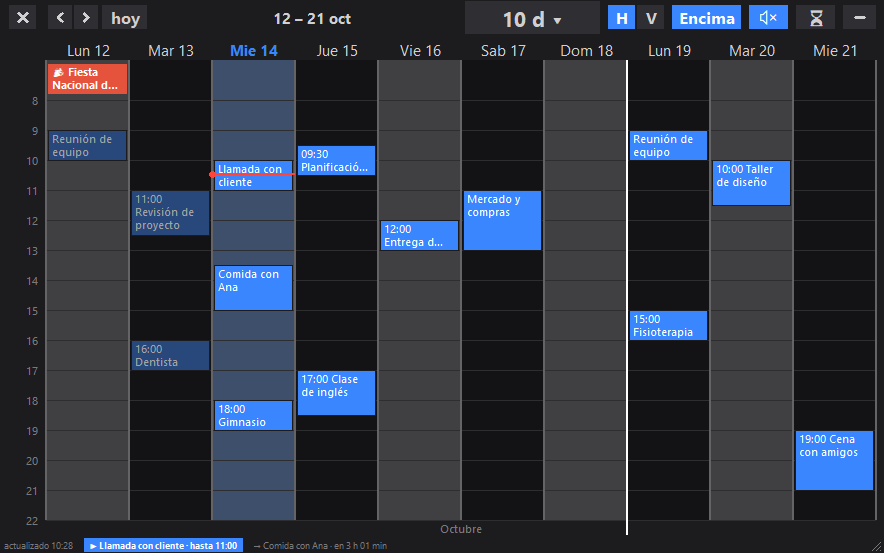

# Widget de calendario para el escritorio de Windows

Muestra tu calendario de Outlook en el escritorio: rejilla por horas, lista,
las dos a la vez o mes completo. Tema oscuro, avisos previos, festivos y
búsqueda. No necesita permisos raros ni cuenta de desarrollador.

## Instalar en un ordenador nuevo

1. Copia **`Calendario 2.0 - Instalador.bat`** (está en la carpeta
   `instaladores`) a una carpeta tuya del ordenador nuevo, por ejemplo una
   carpeta `Calendario` en Documentos. Es un solo fichero: lleva el programa
   dentro. Tiene que ser una carpeta donde puedas escribir.
2. Haz doble clic en él. No hace falta ser administrador. Él solo:
   - crea las subcarpetas `app` (el programa) y `datos` (tu configuración),
   - usa el Python que ya tengas (3.9 o superior, con ventanas gráficas) o, si
     no hay, descarga el Python más reciente de la serie 3.13 en la
     subcarpeta `python` (hace falta internet),
   - instala todas las librerías de `app/requirements.txt` (zonas horarias,
     icono de la bandeja, avisos de Windows, festivos, Outlook...),
   - crea el acceso directo del Escritorio,
   - te pregunta si quieres que arranque solo con Windows,
   - abre el asistente de configuración y, al guardarlo, arranca el widget.
3. Todo queda dentro de la carpeta elegida. No se envía ningún dato a ningún
   sitio.

Para **actualizar** una instalación que ya funciona, pon
**`Calendario 2.0 - Actualizar.bat`** en la carpeta de la instalación (o
ejecútalo desde `instaladores`, dentro de ella) y ábrelo: sustituye el programa,
instala las librerías que falten, actualiza los accesos directos y conserva tu
configuración y tus perfiles. Si vienes de la estructura antigua (todo en una
sola carpeta), también retira los ficheros viejos y tus datos se mueven solos a
`datos` la primera vez que arranca el programa.

Si el asistente no se abre, puedes lanzarlo a mano con `app\configurar.py`.

El asistente (**`configurar.py`**, también se puede abrir suelto) es una
ventana con tres apartados, y **cada uno tiene un enlace azul que abre las
instrucciones** de la carpeta `ayuda`:

1. **De dónde leer los eventos**: del Outlook clásico instalado —te lista los
   calendarios que encuentra, con cuántos elementos tiene cada uno— o de un
   enlace ICS publicado en Outlook web, con el paso a paso para conseguirlo.
2. **Festivos**: tu comunidad autónoma y, si quieres, los dos de tu municipio.
3. **Cómo verlo**: días a la vista, tema y antelación de los avisos.

Todo lo demás (vistas, tamaño, colores, horario visible) se cambia desde el
propio widget y se guarda solo.

## Panel de control, comandos y barra

Todo lo que antes estaba repartido por el clic derecho tiene ahora un sitio
visible:

- **Panel de control** (botón **⚙** de la barra, o clic derecho › *Panel de
  control…*). Siete pestañas con botones: **Vista** (vista, días, orientación,
  nivel, tema, tamaño y transparencia), **Barra** (qué botones salen arriba),
  **Avisos** (campana, antelación, hora de los de todo el día), **Agenda**
  (origen de los eventos, calendarios y festivos), **Correo** (bandeja y una
  gestión de las reglas de Outlook: activar, desactivar, ejecutar ahora,
  eliminar), **Eventos** (próximos 30 días con buscador y filtro por
  calendario, y listas de *solapes* y de eventos *repetidos*; el `⋯` de cada
  fila permite ir a su día, editar, abrir en Outlook, posponer o eliminar) y
  **Sistema** (arranque con Windows, perfiles, copia de la configuración,
  carpetas y dónde se abre cada panel).
- **Paleta de comandos** (botón **⌘**, o **Ctrl+K**). Escribe lo que quieras
  hacer y pulsa Intro: cambiar de vista o de días, abrir cualquier panel,
  cambiar de perfil, activar los avisos, ir a una fecha (`18/9`, `mañana`) o
  saltar a un evento por su título.
- **Barra configurable**: en Panel de control › Barra marcas y desmarcas los
  botones que quieres ver. Los de días, actualizar y ocultar no se pueden
  quitar, y todo sigue disponible con el clic derecho y con Ctrl+K.

**Integrado o en ventana aparte**: el Panel de control y la paleta funcionan
igual que Correo, Hábitos o Cumpleaños. El botón de su cabecera (o el clic
derecho en ella) los cambia entre ventana aparte y anclado a la izquierda o a
la derecha del widget, siguiéndolo cuando se mueve. Panel de control › Sistema
permite elegirlo de golpe para todos los paneles.

## Novedades de la 2.0

- **Alarmas por evento**: clic derecho en un evento › *Alarma antes…* y eliges
  5, 10, 20, 30 o 60 minutos, u otro número. Puedes poner varias en el mismo
  evento. Al llegar la hora suena la alarma, el calendario se pone encima de
  todo y sale un aviso grande; si lo pulsas, te lleva al evento.
- **Sonido de los avisos**: clic derecho › *Datos y avisos* › *Avisos y barra de
  abajo* › *Sonido de los avisos*. Sirve para las alarmas y para los avisos
  antes de cada evento. Puedes usar los sonidos de Windows, uno tuyo en `.wav`
  o ninguno.
- **Solo en un escritorio virtual**: clic derecho › *Ventana y copias* › *Solo en
  este escritorio virtual*. El widget se ve únicamente en el escritorio donde
  lo activaste (las alarmas aparecen igualmente donde estés).
- **Raya blanca de inicio de semana**: una línea blanca a la izquierda de cada
  lunes (encima de la fila, en el modo vertical). Se puede quitar en el mismo
  menú.

## Correo dentro del widget

Igual que la lista y los to-dos, el correo puede ir **dentro** del widget, como
una columna a la derecha (botón **✉** de la barra, clic derecho › *Correo en el
widget*, o Panel de control › Correo). Enseña los correos más recientes de todas
las carpetas mezclados, con remitente, asunto, hora y una barra del color de la
carpeta (sólida si está sin leer).

- **Filtrar por carpeta**: pulsa el chip de una carpeta para ver solo esa
  (pulsarlo otra vez la suelta); *Todas* las enseña todas. El chip *Sin leer*
  deja solo los no leídos.
- **Excluir carpetas**: clic derecho en el chip de una carpeta › *Excluir*, o
  menú `⋯` › *Excluir carpetas*, o marcando y desmarcando las carpetas en Panel
  de control › Correo. Las excluidas no salen en la columna (el aviso
  «🚫 N excluidas · gestionar» permite volver a incluirlas).
- **Sobre un correo**: clic para leerlo sin salir del widget; clic derecho para
  marcarlo leído o no leído, responder, reenviar, abrirlo en Outlook o ver solo
  o excluir su carpeta.
- El ancho se cambia arrastrando el borde izquierdo de la columna, o desde
  `⋯` › *Ancho de la columna*. Los filtros se recuerdan.
- Se puede pedir también desde la paleta de comandos (Ctrl+K): «correo solo no
  leídos», «correo ver solo Facturas», etc.

Los datos son los mismos que usa el panel de correo (se actualizan cada pocos
minutos), y hace falta el Outlook clásico. La columna no sale en la vista de
mes.

## Unión con Post-It

Con [Post-It](https://github.com/Kuerb0/Post-It-App) 1.4 o superior, las dos apps se pasan las citas por una carpeta común: la **Carpeta de Sincronización** de OneDrive (la misma que usa Post-It; se elige en el instalador o en Panel de control › Sistema › Post-It). Si ya tenías la antigua `AgendaCompartida`, se sigue usando hasta que elijas otra:

- En las notas unidas (botón 📅 de la nota), las líneas con hora (`18:30`, `10:00-11:30`, `a las 9`) que estén debajo de una fecha (`Jueves 22/10`) salen en el Calendario como eventos amarillos de ese día (con ✓ si la tarea está marcada). Sin hora o sin fecha encima, no salen.
- Los eventos de la última semana y del próximo mes se escriben en la carpeta. Post-It muestra los de los próximos días en la nota «Agenda del Calendario» y, en las notas unidas, los de cada fecha debajo de esa fecha.

Cada equipo escribe solo su fichero (`notas-<equipo>.json`, `agenda-<equipo>.json`), así que OneDrive no genera copias en conflicto.

**Configuración compartida:** con una carpeta de sincronización elegida, `config.json` y `perfiles/` viven dentro de ella, en `Calendario\` (la primera vez se copian los de antes, que no se tocan), y los ven todos tus equipos. Lo que es de cada ordenador (posición, tamaño, monitores, atajo) se queda en `%LOCALAPPDATA%\WidgetCalendario\equipo.json`, así que mover la ventana no reescribe la configuración común. La carpeta que usa cada equipo está en `%LOCALAPPDATA%\WidgetCalendario\sync.json` (el instalador o el botón del Panel de control la escriben). Código en `app/sincronizar.py`, prueba en `herramientas/test_sincronizar.py`.

## Instalador (2.4)

El instalador es un asistente de varias páginas: explica qué hace, pide la **carpeta de instalación** (local de cada equipo) y, aparte, la **carpeta de sincronización** (opcional, en OneDrive; se propone `Carpeta de Sincronización` del OneDrive personal). Además:

- Si en la carpeta elegida ya hay Calendario, el botón final pasa a **Actualizar** o **Reinstalar**, y se conservan tu configuración y tus perfiles.
- Nunca instala en la raíz de una unidad (`D:\` pasa a `D:\Calendario`), avisa si la unidad es extraíble o de red, y el desinstalador jamás borra una raíz.
- Quita los accesos directos rotos de versiones anteriores y las entradas de «Aplicaciones» sin carpeta.
- Al abrir, el Calendario avisa si hay una versión nueva en GitHub («Sí» descarga el instalador y lo abre); también en el clic derecho › *Buscar actualizaciones…*.
- **Ayuda y atajos** (clic derecho o icono de la bandeja) reúne en una ventana los gestos, atajos y paneles.
- Prueba del instalador: `powershell -File herramientas\test_instalador.ps1` (instala y actualiza en una carpeta temporal).

## Estructura de carpetas

| Carpeta | Qué contiene |
|---|---|
| `app/` | El programa: `calendario.py`, `configurar.py`, `extras.py` (panel de control y paleta), `correo_columna.py` (correo dentro del widget), `menus.py` (menú de clic derecho), `sincronizar.py` (unión con Post-It), `icono.ico`, `ayuda/`, `requirements.txt`, `VERSION.txt`. |
| `datos/` | **Tus datos**: `config.json` (ajustes y tareas permanentes), su copia `config.json.bak`, `perfiles/` y `anteriores/` (copias que deja el actualizador). |
| `instaladores/` | Los dos `.bat` autoextraíbles (se generan con `herramientas/generar_instaladores.py`). |
| `herramientas/` | Para quien mantiene el programa: generador de instaladores, `tests_calendario.py`, `crear_exe.bat`, `limpiar_restos.bat` y las plantillas de los `.bat`. |
| `docs/` | `release-checklist.md`. |
| `python/` | Solo existe si el instalador tuvo que instalar un Python propio. |

Fuera de la carpeta, en `%LOCALAPPDATA%\WidgetCalendario`, se guardan
`cache.pkl`, `registro.txt` y `alternar.senal` (cambian a cada momento y así
OneDrive no los sincroniza). Se generan solos y se pueden borrar.

Si vas a compartir la carpeta, **no incluyas** `datos/`: lleva tu enlace ICS y
deja leer tu calendario entero a quien lo tenga. Para repartir el programa basta
con uno de los `.bat` de `instaladores`.

## Varias personas en la misma carpeta (perfiles)

Si compartes esta carpeta o el repositorio, cada uno guarda **sus datos de
cuenta** en un perfil y se cambia de uno a otro sin volver a escribir nada:

- Arriba a la derecha de la barra pone **el perfil en el que estás** (`👤 Ana`);
  se pulsa y sale el menú de perfiles. También está en el clic derecho.
- **Perfil** → *Guardar estos datos como perfil nuevo…* y le pones tu nombre. Se
  crea `datos/perfiles/tu-nombre.json` y **se abre el asistente** para que rellenes los
  datos de esa cuenta; al cerrarlo, lo escrito se guarda en ese perfil y el
  widget recarga el calendario.
- En ese mismo menú aparecen todos los perfiles: al elegir uno, el widget
  guarda los datos del que estabas usando, carga los del otro y vuelve a leer
  el calendario. También puedes *actualizar* el perfil con los datos de ahora,
  dejar de usar perfiles o borrar uno.
- Si entras en un perfil al que **le faltan los datos**, el asistente se abre
  solo. Para cambiarlos cuando quieras: *Rellenar los datos de este perfil…*.

Un perfil solo se lleva lo que cambia de una persona a otra: origen de los
eventos, enlace ICS, calendarios de Outlook, festivos y zona horaria. El resto
(tamaño, vistas, colores, avisos) es común a la carpeta.

**Importante para GitHub**: no subas `datos/`, la caché ni el
registro (el `.gitignore` ya los excluye): el enlace ICS deja leer tu calendario
entero a quien lo tenga.

## Los dos orígenes de datos

| | Outlook instalado | Enlace ICS publicado |
|---|---|---|
| Etiquetas de Outlook con su color | Sí | No, Outlook.com no las exporta |
| Actualización | Inmediata | Con retardo (Microsoft cachea el ICS) |
| Requisitos | Outlook **clásico** con tu cuenta | Solo el enlace |

El Outlook **nuevo** (`olk.exe`) no admite automatización, así que para esta
vía hace falta el clásico. Si el origen elegido falla, el widget cae en el
otro y lo anota en `registro.txt`.

## Para quien mantiene el programa

1. Cambia lo que haga falta en `app/`.
2. Ejecuta `python herramientas/tests_calendario.py` (debe acabar en "OK").
3. Ejecuta `python herramientas/generar_instaladores.py`: rehace los dos `.bat`
   de `instaladores/` con el código actual y comprueba que se extraen idénticos.
4. Repasa `docs/release-checklist.md` antes de entregar.

Si vienes de la estructura antigua y te quedan ficheros sueltos en la carpeta
principal, `herramientas/limpiar_restos.bat` los borra (pide confirmación y no
toca tus datos). Ejecuta antes el actualizador nuevo para que el acceso directo
apunte a `app`.

`herramientas/crear_exe.bat` compila un único `Calendario.exe` (carpeta `exe`)
que no necesita Python; su configuración se guarda junto al `.exe`.

## Manejo rápido

## Atajos de teclado (hotkeys)

- **F5**: actualiza el calendario manualmente y vuelve a descargar los eventos.
- **Ctrl + Alt + C**: muestra u oculta la ventana desde cualquier aplicación.
- **Ctrl + K**: abre la paleta de comandos (dentro de un cuadro de texto no actúa).
- **Rueda del ratón**: cambia de días; con **Ctrl** escala el tamaño del widget;
  con **Ctrl + Shift** cambia el tamaño de la letra.

> Si haces clic en el calendario y usas **F5**, el programa recarga la información
> sin tener que abrir ni cerrar la ventana ni reiniciar la app.

Al dejar el ratón quieto sobre un botón de la barra o de la fila de acciones del correo aparece una explicación
breve de lo que hace. Al actualizar manualmente se muestra un aviso discreto
de progreso y, al terminar, confirma cuántos eventos se han cargado o explica
si no ha sido posible conectar.

- **Elegir qué carpetas de correo se leen**: Panel de control › Correo › *Carpetas que se leen de Outlook* › *Elegir carpetas…*. Marca las que quieras y guarda; *Automático* vuelve a leer la bandeja y tus carpetas. En los filtros salen solo con el nombre de la carpeta (sin la cuenta).
- **Lista, correo y to-dos dentro del widget**: al abrir la columna de correo o de to-dos, o al pasar de Calendario a Cal + lista, el widget **no se ensancha**: el calendario se estrecha para hacerles sitio. Si prefieres que crezca, desmárcalo en Panel de control › Vista.
- **Botones que no caben**: la barra ya no cambia sola. Si la ventana es estrecha, los botones que no caben pasan al menú del botón **⋯**, siempre los mismos para un ancho dado (los chips de Hábitos y correo tienen ancho fijo, y «hoy» siempre ocupa su sitio).
- **Filtros de correo compactos**: la columna de correo solo lleva botones para unas pocas carpetas (las que tienen correo sin leer, 3 por defecto); el resto está en el menú **▾ más**. El número se cambia en Panel de control › Correo o en el menú ⋯ de la columna. Sin carpetas elegidas a mano, se leen solo la bandeja de entrada de cada cuenta y sus subcarpetas (no las carpetas internas de Outlook).
- **Explicación al pasar el ratón**: ahora sí, sobre cualquier botón de la barra de arriba o de la fila de acciones del correo, tras un momento quieto aparece un cuadro pequeño con lo que hace.
- **Fila de acciones en la columna de correo** (encima de los filtros): **✎** escribe un correo nuevo en Outlook, **✓✓** marca como leído todo lo que se ve ahora mismo (respeta el filtro de carpeta si tienes uno puesto) y **🗀** abre el selector para elegir qué carpetas de Outlook se leen.
- **Control del correo** (clic derecho sobre un mensaje de la columna): leído / no leído, bandera 🚩, responder o reenviar, **archivar** (a la carpeta «Archivo» de esa cuenta), **mover a** otra carpeta, **eliminar** (va a Elementos eliminados en Outlook, se puede recuperar), crear un evento o un to-do con ese correo y abrirlo en Outlook. En «Carpeta…» del mismo menú, o en el menú ⋯ de la columna › *Elegir qué carpetas se leen…*, sale un selector con buscador para poner y quitar carpetas al momento.
- **Menú de clic derecho moderno**: ahora lo dibuja el propio widget (aparece al instante, con el tema, submenús y teclado ↑ ↓ → ← Enter Esc). El menú principal está agrupado en Vista, Datos y avisos, Aspecto, Al crear y mover, Ventana y copias. Si te da algún problema, se apaga en Aspecto › *Menú de clic derecho moderno* y vuelve el de Windows.
- **Redimensionar más cómodo**: los bordes de las columnas de correo y to-dos tienen tirador (tres puntos) que se enciende al pasar el ratón, el arrastre va más fluido y con doble clic vuelven a su ancho por defecto.
- **Tamaño de la barra**: Panel de control › Barra › *Tamaño de la barra* (Pequeña, Media, Grande). Por defecto va en Media; con Grande los botones se ven al doble, pero en un widget estrecho se esconden más.
- **Barra superior**: `✕` (arriba a la izquierda) cierra el widget del todo; `—` lo oculta/minimiza · `‹ ›` navegar · `hoy` · `1 / 3 / 5 / 7 / 14 / 21` días,
  y `…` para escribir cualquier número hasta 365 · `Fest`
  festivos · `+` evento nuevo · `Buscar` · `Hora` (a qué hora empieza y a cuál
  termina lo que se ve, **cada cuántos minutos van las rayas** —10, 15, 20, 30,
  60, 120 o los que escribas—, o ajustarlo a tus eventos) ·
  `Fondo/Normal/Encima` · `Cal / Lista / Ambas / Mes` · **el perfil** (`👤`) ·
  actualizar · ocultar.
- **Tareas locales**: en la lista, pulsa `+` junto a un día o a una fila para
  crear una tarea privada sin abrir Outlook. La casilla de la izquierda la
  completa; `!` indica prioridad alta y `·` prioridad baja. Clic derecho sobre
  una tarea permite editarla o eliminarla. Se guardan en `datos/config.json`
  y no se pierden al actualizar los eventos.
- En clic derecho → **Filtrar** puedes ver solo todas las tareas, las pendientes
  o las completadas. Las tareas urgentes aparecen en rojo, las normales en
  naranja y las de prioridad baja en azul.
- La lista muestra en cada día un resumen de eventos y tareas, un contador de
  progreso en la franja inferior, la duración de las citas y pequeños iconos
  para ubicación (`⌖`) y notas (`▤`). `⚠` avisa de eventos solapados.
- Clic derecho → **Modo concentración: tareas pendientes** deja solo lo que
  queda por hacer. Para volver a todo: clic derecho → **Filtrar** → **Ver todo**.
- Clic derecho sobre el fondo → **Completar tareas anteriores** marca de una vez
  las tareas cuyo horario ya ha terminado.
- En el clic derecho, el menú **Rango** muestra las fechas concretas de cada
  opción, por ejemplo **Hoy · vie 21/ago** o **Próximos 7 días · vie 21/ago –
  jue 27/ago**.
- **Doble clic** en un hueco: crea ahí un evento (viene desactivado; se
  enciende en el clic derecho).
- Al cambiar de días (7, 14, 21, los que sean) **la ventana no crece**: las
  columnas se reparten el sitio que ya ocupaba. Si quieres otro tamaño,
  arrastra los bordes; a partir de ahí ese es el nuevo hueco.
- **Barra entre el calendario y la lista**: arrástrala para dar más sitio a uno
  o a otro. La ventana sigue midiendo lo mismo.
- Clic derecho → **La lista va…**: a la derecha, a la izquierda, arriba o
  abajo. Puestas arriba o abajo, la lista ocupa todo el ancho y la barra
  reparte la altura.
- Clic derecho → **Transparencia**: del 30 % al 100 %, con la opción de
  escribir el porcentaje.
- **Crear y cambiar eventos sin salir del widget**: el botón `+` abre una ficha
  con título, día, horas, todo el día, lugar, etiqueta y notas, y la guarda
  directamente en Outlook. **Doble clic** sobre un evento (o clic derecho →
  *Cambiar este evento…*) abre esa misma ficha ya rellena. Necesita el Outlook
  clásico instalado. En *Etiqueta* hay un desplegable (`▾`, o la flecha abajo)
  con las que ya has usado, y lo mismo en *Dónde*. Hay atajos de duración
  (15m, 30m, 1 h, 1½ h, 2 h) y de correr el evento un día adelante o atrás, y
  un selector de **repetición** (todos los días, de lunes a viernes, cada
  semana, cada dos semanas, cada mes, cada año) que luego pregunta hasta qué
  fecha o cuántas veces. Con el enlace ICS el calendario es de solo lectura, y los
  eventos que se repiten se siguen cambiando desde Outlook. Si prefieres que el
  `+` abra Outlook como antes, se cambia en clic derecho → *Crear los eventos en*.
- **Arrastrar un evento** dentro de la rejilla lo cambia de hora o de día y lo
  guarda en Outlook (solo con el Outlook clásico instalado; los que se repiten
  hay que moverlos desde Outlook). Sale un aviso con *deshacer*. Se apaga en el
  clic derecho.
- **Franja de abajo**: lo que está pasando ahora y lo siguiente con su cuenta
  atrás; se pulsa para ver el detalle.
- **Aviso propio** en la esquina antes de cada evento, además de la
  notificación de Windows. Clic derecho → *Avisos y barra de abajo* para
  encenderlo, apagarlo o ver cómo queda.
- **Pintar un rato con el ratón** sobre la rejilla vacía abre la ficha con esas
  horas ya puestas. **Arrastrar el borde de abajo** de un evento lo alarga o lo
  acorta (el de la derecha en modo vertical).
- **Clic derecho** sobre un evento: **tacharlo** cuando ya está hecho (se queda
  gris y con la letra tachada, y no toca nada de Outlook), **posponerlo**
  (+15 / +30 / +1 h / mañana / la semana que viene), cambiarle la **etiqueta y
  el color**, marcarlo como **ocupado, provisional o libre**, **duplicarlo**,
  **guardarlo como plantilla**, **eliminarlo** (pregunta antes y va a
  *Elementos eliminados* de Outlook, así que se puede recuperar), copiarlo o
  filtrar por su etiqueta.
- **Plantillas**: clic derecho en el fondo → *Crear desde una plantilla…* para
  levantar en dos clics los eventos de siempre (título, duración, lugar y
  etiqueta ya puestos).
- En clic derecho → *Tachados* puedes hacer que **lo ya pasado se tache solo** y
  borrar todos los tachados de golpe.
- **Clic derecho** en el fondo → *Texto de la lista*: cuántas líneas puede
  ocupar cada título antes de cortarlo (1 a 4).
- **Rueda**: mueve los días. Sobre la columna de horas, mueve el horario.
  Con **Ctrl**, agranda o encoge todo el widget; con **Ctrl + Mayús**, solo el
  tamaño de la letra (también en clic derecho → *Tamaño de la letra*).
- **Icono junto al reloj**: clic para mostrar u ocultar; clic derecho para el
  menú completo, incluido *"No la encuentro: traerla al centro"*.
- **Ctrl+Alt+C** (configurable en `atajo_global`): mostrar u ocultar desde
  cualquier aplicación.

## El aviso de Outlook «un programa intenta obtener acceso…»

Ese cartel lo saca el propio Outlook cuando un programa lee el **cuerpo** de
una cita. Por eso el widget **no lee las notas** de serie: título, hora, lugar,
etiqueta y estado no lo disparan. Si las quieres, en clic derecho →
*Leer los eventos de* → **«Leer también las notas»**; primero se intenta por una
vía que no suele avisar y, si no puede, entonces sí lo pedirá.

Si aun así te sale (o quieres quitarlo del todo), depende de Windows, no del
widget: suele deberse a que Windows no ve un antivirus al día. Con Outlook
abierto: *Archivo → Opciones → Centro de confianza → Configuración del Centro
de confianza → Acceso mediante programación*. Ahí se elige cuándo avisar; la
opción de no avisar nunca puede requerir permisos de administrador.

## Si algo va mal

1. Cierra el widget **del todo**: icono de la bandeja → *Salir*. Abrir el
   acceso directo estando ya abierto solo lo muestra u oculta.
2. Mira `registro.txt` (en `%LOCALAPPDATA%\WidgetCalendario`): guarda los
   errores, la posición de la ventana y de dónde se han leído los eventos.
3. Si sigue sin funcionar, vuelve a ejecutar el instalador en la misma carpeta:
   lo que ya estaba instalado no se repite y tus datos no se tocan.

## Ajustes útiles de `datos/config.json`

| Clave | Qué hace |
|---|---|
| `origen` | `"ics"`, `"outlook"` o `"auto"`. |
| `carpetas_outlook` | Qué calendarios de Outlook leer, con nombre y color. |
| `calendarios` | Lista de enlaces ICS, cada uno con su nombre y color. |
| `avisos_minutos` | Antelación de los avisos, por ejemplo `[60, 10]`. |
| `aviso_todo_dia` | Hora del aviso de lo que dura todo el día (`null` lo quita). |
| `dias_cache_adelante` | Cuántos días se descargan para poder navegar. |
| `atajo_global` | Atajo de teclado, por ejemplo `"ctrl+shift+k"`. |
| `crear_con` | `"auto"` (Outlook web relleno), `"nuevo"` o `"outlook"`. |
| `escala` | Tamaño general, de 0.7 a 2.0. |

## Licencia

Este programa es software libre bajo la licencia [GNU GPL v3](LICENSE): puedes usarlo, estudiarlo, modificarlo y compartirlo, y las versiones modificadas que publiques deben seguir siendo libres bajo la misma licencia.
